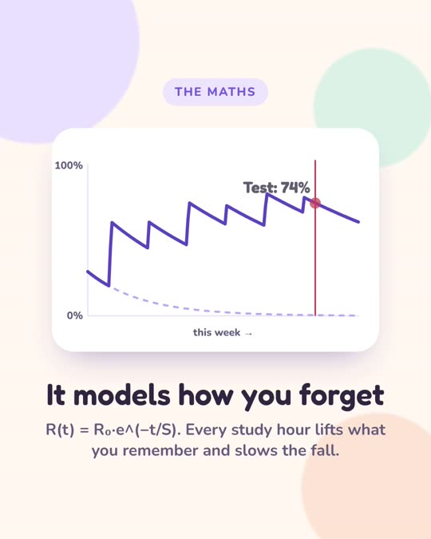
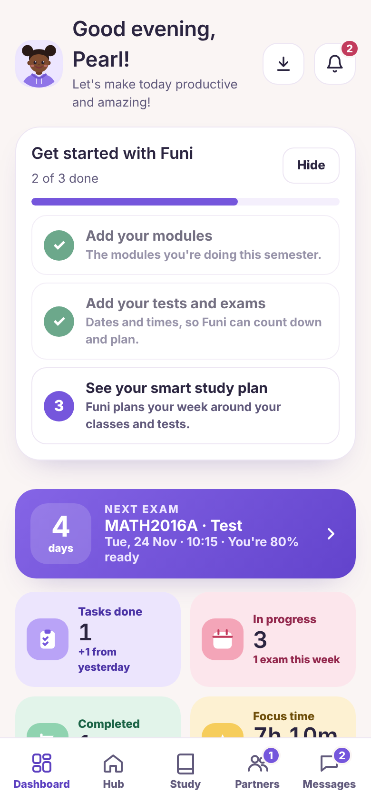
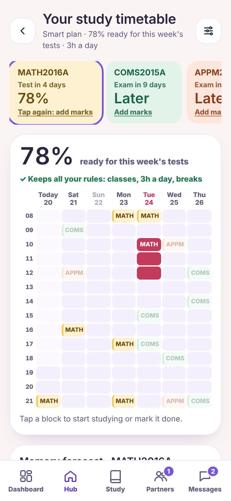
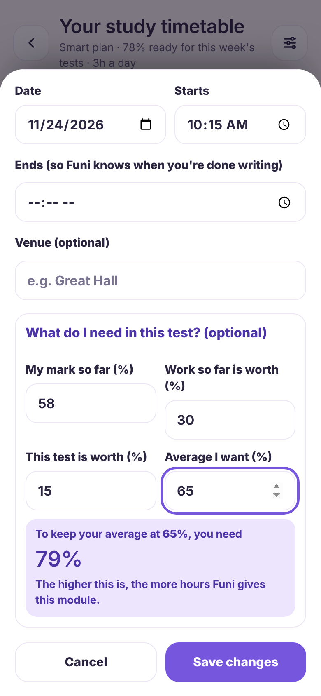
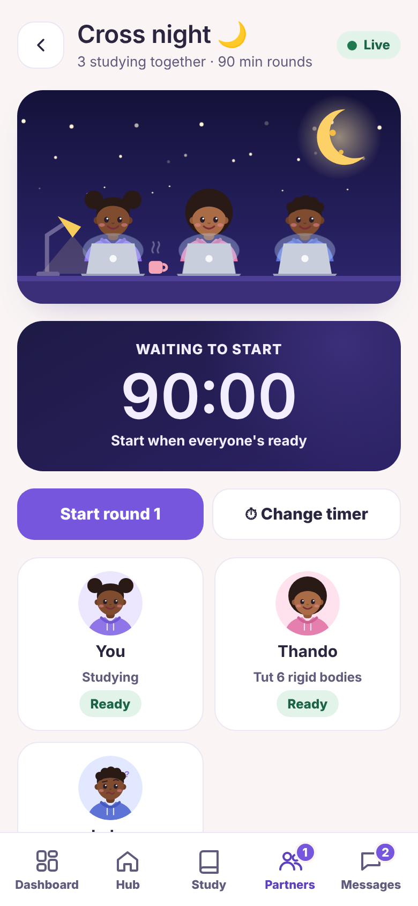
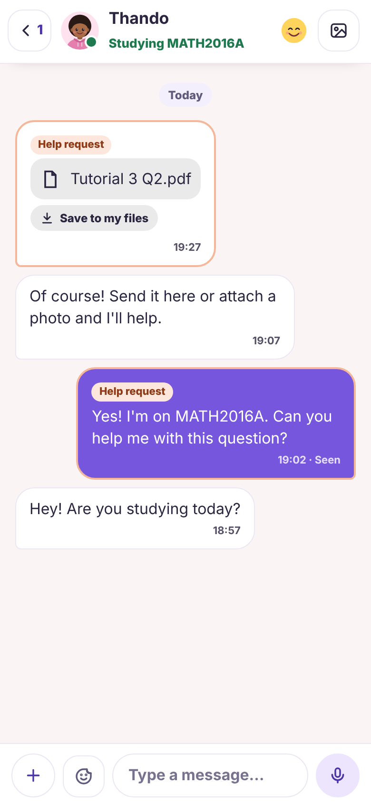
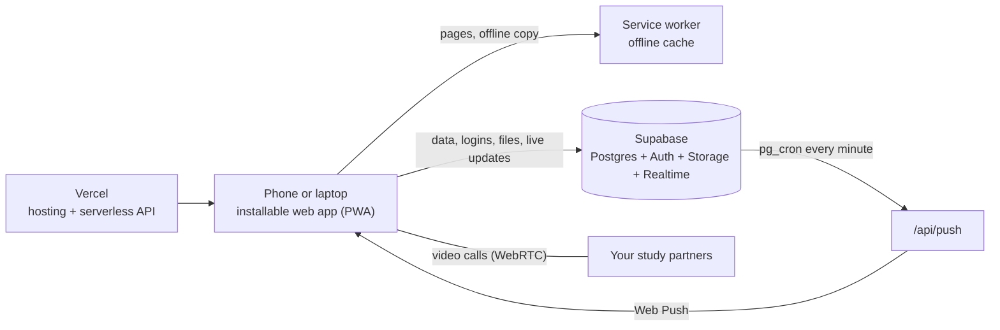

# Study with Funi

**A free study app for university students. It plans your week with a model of how you forget, so you remember the most on test day.**

Live: **[study-with-funi.vercel.app](https://study-with-funi.vercel.app)** · Built by **Lufuno Pearl Moyo**, BSc Mathematics, Applied Mathematics and Computer Science at Wits.

<a href="https://study-with-funi.vercel.app/docs/funi-demo.mp4"></a><br>
▶ **[Watch the 60-second demo](https://study-with-funi.vercel.app/docs/funi-demo.mp4)**

<table>
  <tr>
    <td></td>
    <td></td>
    <td></td>
    <td></td>
    <td></td>
  </tr>
</table>

## Why I built it

In exam season I had six modules, four tests in one week and no clear idea what to study first. The planners I tried were just calendars: you still had to decide everything yourself. I wanted an app that knows your tests, your marks and your classes, and works out the plan for you. And it had to make studying less lonely. So I built Funi and shared it with other students.

## What it does

**Plan**
- Countdowns for every test and exam, which move to a **Written ✓** list when you finish writing.
- **A marks book** for each module: tests, tuts (with "best 4 count" rules), assignments and the exam, with their weights. It works out your average so far, the mark you need on what's left, and warns you about DP and exam subminimums.
- A **smart study timetable** for the next 7 days, fitted around your classes (see the maths below).
- Tasks and reminders that notify your phone, even when Funi is closed.

**Study**
- Focus sessions with a timer that **follows you between your phone and laptop**, plus a study history by day and module.
- Files for each module (notes, past papers, photos, links) that **open offline**.
- Handwritten notes that tidy your writing onto the lines, and flashcards with quiz battles.

**Together**
- Study partners, chat with voice notes, files and your own WhatsApp stickers.
- Study rooms with a shared timer, **Cross night** for all-nighters, and video calls with a live whiteboard.
- **My House**, a small study group: a nightly quiz with a crown 👑, weekly dares, an exam war room for sending "all the best" before exams, past paper sprints with a page scanner, and a shared mistake bank.

## The maths: a smart study timetable

Most planners hand out study time by turns. Funi treats your week as an **optimisation problem**, built on a **model of forgetting**.

**1. Memory decays.** For each module, *R* is how much you remember (0 to 1) and *S* is how stable that memory is, in days:

$$R(t) = R_0 \, e^{-t/S}$$

**2. A study hour lifts the memory and makes it more stable.** It is more stable the more you had forgotten, which is the spacing effect. A second hour of the same module in a row counts for less, so the model prefers spreading a module out:

$$R \leftarrow R + g\,(1 - R) \qquad S \leftarrow S + c\,(1 - R_{\text{before}})$$

**3. The goal.** Choose a module (or a break) for every free hour $x$ in the next 7 days to maximise how much you remember on each test day. The weight $w_i$ grows with the mark you need in that test:

$$\max_x \; \sum_i w_i \, R_i(t_{\text{test},i}) \; - \; \text{penalties}(x)$$

The constraints come from real life: only free hours (not in class, not during a test), your daily limit, a break after 3 hours in a row, and nothing for a module after its test.

**4. Solving it.** The model is simulated hour by hour over the week (168 steps). A **greedy** pass makes a first plan by giving each hour to the module losing the most memory, weighted by how close its test is. **Simulated annealing** then improves it with thousands of small changes: move one hour, or swap two. Better plans are always kept, and worse ones are sometimes kept early on, with probability $e^{-\Delta/T}$, so the search doesn't get stuck. The temperature $T$ cools each step. A seeded random generator keeps the plan the same all day, and it is only planned again when your tests, marks or settings change.

On a sample week, taking turns (the old planner) planned 10 hours for modules whose test had already happened. The optimised plan breaks none of the rules, and it raises the predicted memory on test day from about 60% to about 80%.

Code: [`js/smartplan.js`](js/smartplan.js) (the model and optimiser), connected to the app in [`js/study.js`](js/study.js).

## How it's built



| Part | What I used |
|---|---|
| Front end | Plain HTML, CSS and JavaScript (no framework), installable as a PWA |
| Database and logins | Supabase: Postgres with row-level security, Auth, Storage, Realtime |
| Server code | SQL functions in Postgres and Vercel serverless functions (`/api`) |
| Scheduled jobs | `pg_cron` for reminders, quiz countdowns and house rules |
| Notifications | Web Push (VAPID) from `/api/push` |
| Calls | WebRTC with a TURN relay, plus a shared canvas whiteboard |
| Hosting cost | R0: Vercel Hobby and Supabase free plans |

## Problems I had to solve

- **One study session on two devices.** A session started on your phone carries on, on your laptop, through Postgres Realtime. The app's own updates come back to it as an echo a moment later, which at first un-paused a timer you had just paused. Each device now ignores echoes of its own actions for a few seconds.
- **Phones that wake up offline.** Phones often reopen Funi before the internet is ready, which used to log people out. Funi now retries the login and opens with the saved session. It only logs you out when the server says the login is truly invalid.
- **Offline first.** The service worker caches the app, your data and your module files, so notes and past papers still open with no data.
- **Privacy by design.** Every table has row-level security policies. Your marks are never shared with partners or your house, and the owner-only statistics come from a function that checks who is asking.
- **Fair rules in a group.** House quiz rankings use the average per question, so you don't lose for playing less. Only people who played can come last. Who chooses the dare rotates fairly, and missed dares are handled by a scheduled job.
- **Privacy you can act on.** A plain-language privacy page (POPIA), *Download my data* as a file, and *Delete my account*, which removes your files and data and hands any house you own to another member.
- **Free-tier limits.** Images are shrunk on the phone before uploading, voice notes expire after 7 days, and storage limits are checked in the database.

## Project layout

```
index.html, styles.css     all screens and themes
js/smartplan.js            forgetting model + greedy + simulated annealing
js/study.js                tests, marks, timetable, focus sessions, study history
js/social.js, stickers.js  partners, chat, voice notes, stickers
js/house.js, housefun.js   My House: files, quiz, dares, sprints, war room
js/call.js, fun.js         video calls + whiteboard, study rooms, Cross night
js/notes.js, files.js      handwritten notes, module files, offline copies
api/                       Vercel functions: config, push notifications, TURN
funi-v*-setup.sql          database changes, run in order (tables, policies, functions, jobs)
sw.js, manifest.json       offline support and install
```

## Running your own copy

See **[docs/SETUP.md](docs/SETUP.md)** for the database, accounts, email and notification setup.
